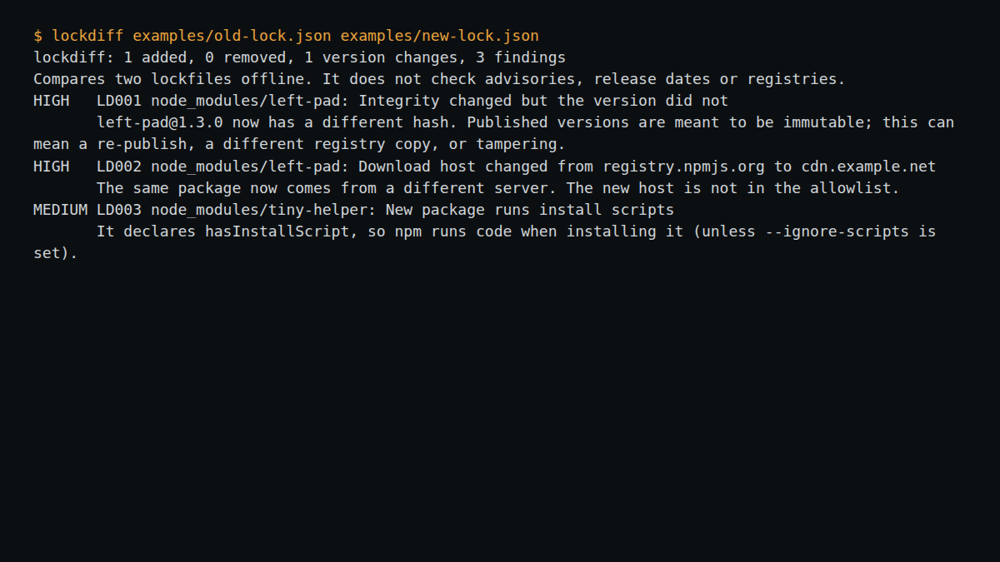

# lockdiff

Offline review of what changed in a `package-lock.json`, aimed at tamper signals rather than advisories. It reads two files (or a git revision and the working copy), makes no network requests, has no dependencies (Python 3.9+), and exits non-zero on a threshold so it can gate a pull request.

```bash
lockdiff old-lock.json new-lock.json
lockdiff --git origin/main package-lock.json --fail-on high
lockdiff old.json new.json --format markdown     # paste into a PR comment
lockdiff old.json new.json --registry-host npm.internal.example   # trusted mirrors
lockdiff old.json new.json --format sarif        # GitHub code scanning / SARIF viewers
```

Try the included example: `PYTHONPATH=src python -m lockdiff examples/old-lock.json examples/new-lock.json`.

## Checks

| ID | Signal | Severity |
| --- | --- | --- |
| LD001 | Integrity hash changed but the version did not | high |
| LD002 | Download host changed, or host not on the allowlist (default `registry.npmjs.org`) | high / medium |
| LD003 | Package newly runs install scripts (new package, or gained them) | medium / high |
| LD004 | SHA-1 integrity, or algorithm weakened | medium |
| LD005 | Plain HTTP; git dependency not pinned to a commit | high / medium |
| LD006 | No integrity hash, or hash removed | medium |
| LD007 | Downgrade (medium); major upgrade (info) | medium / info |
| LD009 | Registry tarball path names a different package than the entry | high |

## Limits

- npm `package-lock.json` (v1, v2, v3) and Yarn Classic `yarn.lock` (v1). Yarn Berry (v2+) and `pnpm-lock.yaml` are detected and refused with a clear message, not misread. Yarn v1 records neither install scripts nor a dev flag, so LD003 is skipped for it. A Yarn entry is identified by its first descriptor (for example `lodash@^4.17.0`); if a lockfile regeneration changes the descriptors, entries show as added and removed.
- No advisory, release-age or registry lookups: use it next to tools that do those. See [docs/RESEARCH.md](docs/RESEARCH.md) for what I did and did not compare.
- LD001 can be a legitimate event (a registry republish or mirror re-pack); it asks for a human decision, it does not prove tampering.
- Install scripts are not recorded in v1 lockfiles, so LD003 is skipped for them (the report says so).
- Tested on fixtures I wrote plus one real Yarn 1 lockfile (107 entries, no false positives), not on a corpus of real lockfiles.

## Roadmap

Not done yet, in rough order of value:

- `pnpm-lock.yaml` and Yarn Berry support.
- An opt-in mode that checks a package's age or advisory status, kept clearly separate from the offline, no-network default.
- Testing against a corpus of real-world lockfiles rather than hand-written fixtures, to find rule false positives at scale.

## Development

`python -m unittest discover -s tests` (30 tests, including a real `git` round trip and a lockfile generated by Yarn 1).

Not yet independently reviewed; the tests and documented limits describe what has been checked. MIT licence.

Designed and built by Maak — https://github.com/0xM44k

## Evidence



The image above is a capture of the command shown at the top of the image, run against the files in this repository on 2026-10-28. It is the tool's actual output, rendered in a terminal panel for legibility; no output lines were invented.
